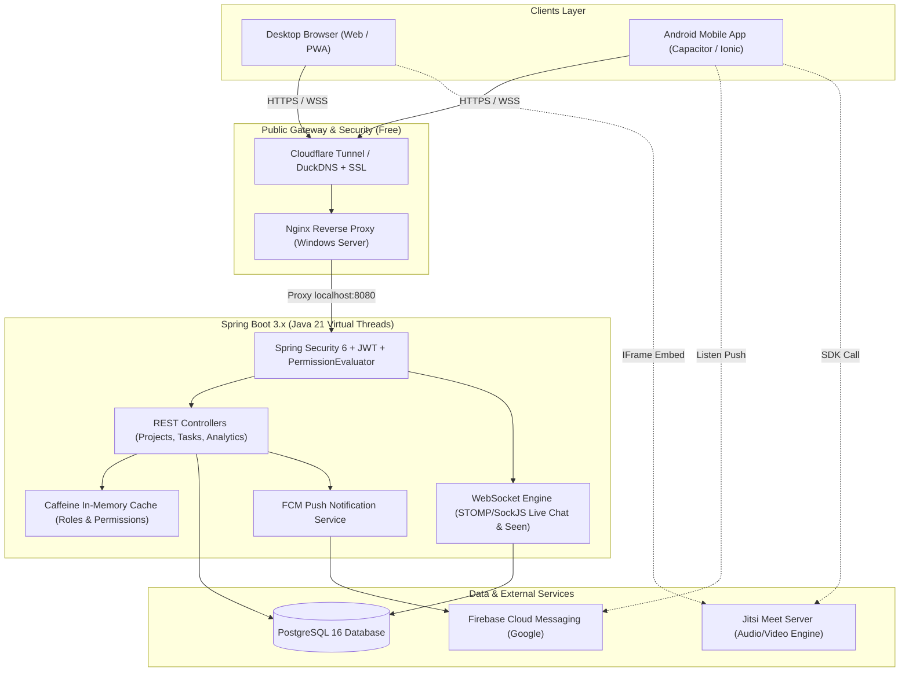

# 🚀 SyncFlow — Next-Gen Collaborative Project Management & Team Ops System

> **SyncFlow** হলো একটি ১০০% ফ্রি, ওপেন ও হাইলি স্কেলেবল এন্টারপ্রাইজ প্রজেক্ট ম্যানেজমেন্ট এবং রিয়েল-টাইম টিম কোলাবোরেশন প্ল্যাটফর্ম। এটি একটি একক কোডবেস থেকে ডেস্কটপ ব্রাউজার (Web/PWA) এবং অ্যান্ড্রয়েড অ্যাপ (.apk) সাপোর্ট করে, ব্যাকএন্ডে জাভা ২১-এর ভার্চুয়াল থ্রেড ভিত্তিক স্প্রিং বুট আর্কিটেকচার দ্বারা পরিচালিত।

---

## 📑 সূচিপত্র (Table of Contents)
- [১. সিস্টেম ওভারভিউ ও মূল উদ্দেশ্য](#১-সিস্টেম-ওভারভিউ-ও-মূল-উদ্দেশ্য)
- [২. ১০০% ফ্রি ও হাইলি স্কেলেবল টেক স্ট্যাক](#২-১০০-ফ্রি-ও-হাইলি-স্কেলেবল-টেক-স্ট্যাক)
- [৩. সিস্টেম আর্কিটেকচার ডায়াগ্রাম](#৩-সিস্টেম-আর্কিটেকচার-ডায়াগ্রাম)
- [৪. ডাইনামিক রোল ও গ্র্যানুলার পারমিশন ইঞ্জিন (RBAC)](#৪-ডাইনামিক-রোল-ও-গ্র্যানুলার-পারমিশন-ইঞ্জিন-rbac)
- [৫. রোল ভিত্তিক কোর ওয়ার্কফ্লো](#৫-রোল-ভিত্তিক-কোর-ওয়ার্কফ্লো)
  - [ক. Reporting Manager](#ক-reporting-manager-executive-control--analytics)
  - [খ. Team Lead](#খ-team-lead-project-architecture--squad-execution)
  - [গ. Developer](#গ-developer-focused-workspace--collaboration)
- [৬. স্মার্ট প্রোডাক্টিভিটি ও ভ্যালু-অ্যাডেড ফিচারসমূহ](#৬-স্মার্ট-প্রোডাক্টিভিটি-ও-ভ্যালু-অ্যাডেড-ফিচারসমূহ)
- [৭. রিকমেন্ডেড রিপোজিটরি ও ফোল্ডার স্ট্রাকচার](#৭-রিকমেন্ডেড-রিপোজিটরি-ও-ফোল্ডার-স্ট্রাকচার)
- [৮. উইন্ডোজ সার্ভার হোস্টিং ও জিরো-কস্ট ডিপ্লয়মেন্ট গাইড](#৮-উইন্ডোজ-সার্ভার-হোস্টিং-ও-জিরো-কস্ট-ডিপ্লয়মেন্ট-গাইড)

---

## ১. সিস্টেম ওভারভিউ ও মূল উদ্দেশ্য

SyncFlow-এর মূল উদ্দেশ্য হলো প্রজেক্ট লাইফসাইকেল ট্র্যাকিং, টাস্ক ম্যানেজমেন্ট, ডিসকর্ড-স্টাইল রিয়েল-টাইম চ্যাট এবং ইন-অ্যাপ অডিও/ভিডিও কনফারেন্সিং-কে এক ছাদের নিচে নিয়ে আসা। কোনো থার্ড-পার্টি পেইড সাবস্ক্রিপশন ছাড়াই উইন্ডোজ ইকোসিস্টেমে সর্বোচ্চ পারফরম্যান্স নিশ্চিত করা।

### প্রধান হাইলাইটস:
- **একক ক্রস-প্ল্যাটফর্ম কোডবেস**: Web, PWA এবং Android APK (Angular 18 + Ionic/Capacitor)।
- **আল্ট্রা-লো ল্যাটেন্সি ও ভার্চুয়াল থ্রেডস**: Java 21 Project Loom (Virtual Threads) দিয়ে সীমিত হার্ডওয়্যারে লক্ষাধিক কনকারেন্ট রিকোয়েস্ট হ্যান্ডলিং।
- **জিরো সফটওয়্যার লাইসেন্স কস্ট**: সম্পূর্ণ ফ্রি ও ওপেন-সোর্স লাইব্রেরি ও ফ্রি-টিয়ার ক্লাউড সার্ভিস (Cloudflare Tunnel, Firebase FCM, Jitsi Meet)।

---

## ২. ১০০% ফ্রি ও হাইলি স্কেলেবল টেক স্ট্যাক

| Layer | Technology & Tools | Why / Purpose | Free Tier / Open Source Status |
| :--- | :--- | :--- | :--- |
| **Frontend & Mobile App** | **Angular 18+ + Ionic UI / Capacitor** | একক কোডবেস থেকে পিসি ব্রাউজার (Web/PWA) এবং অ্যান্ড্রয়েড অ্যাপ (.apk) তৈরি। | 100% Free & Open Source (MIT / Apache) |
| **Backend API** | **Spring Boot 3.x (Java 21 Virtual Threads)** | রেস্ট এপিআই, বিজনেস লজিক এবং জাভা ২১-এর ভার্চুয়াল থ্রেড দিয়ে হাজার হাজার রিকোয়েস্ট জিরো ল্যাগে হ্যান্ডেল করা। | 100% Free & Open Source |
| **Security & RBAC** | **Spring Security 6 + JWT + Custom Permission Evaluator** | ডাইনামিক রোল এবং গ্র্যানুলার পারমিশন (মডিউল ভিত্তিক চেকবক্স) হ্যান্ডেল করা। | 100% Free & Open Source |
| **Real-Time Chat & Seen** | **Spring WebSocket (STOMP + SockJS)** | ডিসকর্ডের মতো লাইভ চ্যাট, মেসেজ Seen স্ট্যাটাস এবং লাইভ কানবান বোর্ড আপডেট। | 100% Free & Open Source |
| **Video/Audio Meeting** | **Jitsi Meet SDK / IFrame API** | জুম বা গুগলের মতো ফ্রি ইন-অ্যাপ অডিও/ভিডিও কল ও স্ক্রিন শেয়ারিং (নো লিমিট)। | 100% Free Open Source Service |
| **Database & Caching** | **PostgreSQL 16 (or MySQL 8) + Caffeine In-Memory Cache** | ডাটা স্টোরেজ এবং পারমিশন ও ফ্রিকোয়েন্ট কুয়েরি দ্রুত করার জন্য র্যাম ক্যাশিং। | 100% Free & Open Source |
| **Push Notifications** | **Firebase Cloud Messaging (FCM)** | অ্যাপ বন্ধ বা ব্যাকগ্রাউন্ডে থাকা অবস্থায় মোবাইলে ইনস্ট্যান্ট টাস্ক বা চ্যাট নোটিফিকেশন পাঠানো। | FCM Free Tier (Unlimited push) |
| **Server & Hosting** | **Windows Server + Nginx + WinSW (Service Wrapper)** | উইন্ডোজ সার্ভারে স্প্রিং বুট ব্যাকগ্রাউন্ড সার্ভিস হিসেবে ২৪/৭ সচল রাখা ও রিভার্স প্রক্সি। | 100% Free Open Source Tools |
| **Public Access & SSL** | **Cloudflare Tunnel OR DuckDNS + Let's Encrypt** | পোর্ট ফরওয়ার্ডিং বা পাবলিক আইপি ছাড়া সম্পূর্ণ ফ্রি https:// এবং রিমোট কানেকশন। | 100% Free |

---

## ৩. সিস্টেম আর্কিটেকচার ডায়াগ্রাম



---

## ৪. ডাইনামিক রোল ও গ্র্যানুলার পারমিশন ইঞ্জিন (RBAC)

1. **Custom Role Creator**:
   - অ্যাডমিন প্যানেল থেকে যেকোনো সময় নতুন রোল তৈরি করা যাবে (যেমন: `Reporting Manager`, `Team Lead`, `Senior Dev`, `Junior Dev`, `SQA`, `Observer`)।
2. **Granular Permission Matrix**:
   - প্রতিটি রোলের জন্য মডিউল ভিত্তিক আলাদা চেকবক্স গ্রিড থাকবে:
     - **Modules**: `Project`, `Task`, `Pipeline Stages`, `Chat Channels`, `Meetings`, `User Management`, `Performance Reports`.
     - **Operations**: `Create`, `View`, `Edit`, `Delete`, `Approve`, `Assign`, `Host Meeting`.
3. **User-Level Permission Override**:
   - ইউজারের গ্লোবাল রোল অক্ষুণ্ণ রেখেই কোনো নির্দিষ্ট প্রজেক্ট বা কাজের জন্য স্পেশাল পারমিশন যোগ বা প্রত্যাহার করা যাবে।
4. **Invite-Only Authentication**:
   - উন্মুক্ত পাবলিক রেজিস্ট্রেশন নেই। শুধুমাত্র অ্যাডমিন বা অনুমোদিত ম্যানেজার অ্যাকাউন্ট তৈরি বা ইনভাইট লিংক পাঠাতে পারবেন। প্রথমবার লগইনে পাসওয়ার্ড চেঞ্জ ও 2FA অপশন থাকবে।

---

## ৫. রোল ভিত্তিক কোর ওয়ার্কফ্লো

### ক. Reporting Manager (Executive Control & Analytics)
- **Project & Lifecycle Management**: নতুন প্রজেক্ট তৈরি, স্টার্ট/এন্ড ডেট নির্ধারণ এবং লাইফসাইকেল স্ট্যাটাস (`Active`, `On Hold`, `Completed`) নিয়ন্ত্রণ।
- **Team & Leadership Setup**: বিভাগ অনুযায়ী স্কোয়াড তৈরি, মেম্বার যুক্ত করা এবং টিম লিড নমিনেশন।
- **Full Override Control**: প্রয়োজনবোধে টিম লিডের সাজানো স্টেজ রদবদল বা সরাসরি যেকোনো ডেভেলপারকে স্পেশাল প্রায়োরিটি টাস্ক অ্যাসাইন করা।
- **360° Live Executive Dashboard**:
  - সব প্রজেক্টের লাইভ প্রগ্রেস (%) ও স্টেজ ভিউ।
  - প্রজেক্ট হেলথ মেট্রিক্স (On-Track vs At-Risk vs Delayed)।
- **Developer Performance Analytics**:
  - **On-Time Delivery Rate**: ডেডলাইনের মধ্যে টাস্ক কমপ্লিট হওয়ার হার।
  - **Quality / Approval Score**: রিভিউ বা QA স্টেজে কাজ রিজেক্ট/রিভিশনে যাওয়ার হার (যত কম, স্কোর তত বেশি)।
  - **Workload Heatmap**: কার হাতে বর্তমানে কয়টি Active টাস্ক আছে (ব্যালান্সড, ওভারলোডেড নাকি আইডিয়াল)।
- **Comment & Review Authority**: যেকোনো টাস্ক বা প্রজেক্টে হাই-লেভেল ইনস্ট্রাকশন, কমেন্ট এবং ফাইনাল এপ্রুভাল দেওয়া।
- **Global & Team Meetings**: এক ক্লিকে পুরো ডিপার্টমেন্ট বা নির্দিষ্ট টিমের সাথে ইনস্ট্যান্ট অডিও/ভিডিও মিটিং শুরু করা।

---

### খ. Team Lead (Project Architecture & Squad Execution)
- **Custom Stage / Pipeline Builder**: প্রতিটি প্রজেক্টের ধরন অনুযায়ী কাস্টম স্টেজ ডিফাইন করা:
  $$\text{Backlog} \longrightarrow \text{DB Design} \longrightarrow \text{API} \longrightarrow \text{UI} \longrightarrow \text{Review} \longrightarrow \text{Done}$$
- **Task Breakdown & Assignment**: মূল ফিচারকে ছোট ছোট টাস্ক ও সাব-টাস্কে ভাগ করে প্রায়োরিটি (`Low`, `Medium`, `High`, `Critical`) ও ডেডলাইনসহ ডেভেলপারদের অ্যাসাইন করা।
- **Review & Approval Queue**: ডেভেলপাররা রিভিউতে পাঠালে পুল-রিকোয়েস্টের মতো টাস্ক চেক করা, ফিডব্যাক কমেন্ট দেওয়া, এপ্রুভ করে পরের স্টেজে পাঠানো বা রিভিশনে ব্যাক পাঠানো।
- **Discord-Style Channel Creation**: প্রজেক্ট বা মডিউল ভিত্তিক আলাদা ডিসকাশন চ্যানেল খোলা (যেমন: `#api-discussion`, `#ui-bugs`, `#release-1.0`)।
- **Team Meeting Host**: নিজের স্কোয়াডের সদস্যদের নিয়ে ডেইলি স্ট্যান্ডআপ বা বাগ সলভিং মিটিং হোস্ট করা।

---

### গ. Developer (Focused Workspace & Collaboration)
- **Personal Workspace & Kanban Board**: শুধুমাত্র নিজের অ্যাসাইন করা কাজগুলো প্রায়োরিটি ও ডেডলাইন অনুসারে সাজানো দেখা। ড্র্যাগ-অ্যান্ড-ড্রপ করে স্ট্যাটাস পরিবর্তন (`To-Do` $\rightarrow$ `In Progress` $\rightarrow$ `Review`)।
- **Progress Slider & Activity Logs**: টাস্কের অগ্রগতি স্লাইডার ($0\%$ - $100\%$) ড্র্যাগ করে আপডেট করা, কোড স্নিপেট বা স্ক্রিনশট অ্যাটাচমেন্ট সহ কমেন্ট পোস্ট করা।
- **Discord-Style Chat & Seen Status**:
  - `#general` গ্লোবাল কমিউনিকেশন।
  - প্রজেক্ট-স্পেসিফিক চ্যানেলে ডিসকাশন, রিচ টেক্সট ও ফাইল শেয়ার।
  - **Read Receipts ("Seen by...")**: সেন্ট মেসেজে ক্লিক বা হোভার করলে কে কে কখন দেখেছে তা রিয়েল-টাইমে দেখা।
- **One-Tap Meeting Join**: ইন-অ্যাপ নোটিফিকেশন বা চ্যানেলের মিটিং কার্ডে এক ট্যাপে সরাসরি ভিডিও কলে সংযুক্ত হওয়া।

---

## ৬. স্মার্ট প্রোডাক্টিভিটি ও ভ্যালু-অ্যাডেড ফিচারসমূহ

| ফিচার | বিবরণ | ইমপ্যাক্ট |
| :--- | :--- | :--- |
| **"Raise a Blocker" Alert** | ডেভেলপার কোডিং, লজিক বা সার্ভার সমস্যায় আটকে গেলে টাস্কে `Blocked` ফ্ল্যাগ অন করে কারণ লিখবে। সাথে সাথে ম্যানেজার ও লিডের ড্যাশবোর্ডে লাল ওয়ার্নিং ফ্ল্যাশ করবে। | কাজের অচলাবস্থা তৎক্ষণাৎ সমাধান হয়। |
| **Leave & Availability Status** | কোনো মেম্বার `On Leave` দিলে তার প্রোফাইল ব্যাজে ছুটির স্ট্যাটাস দেখাবে। ছুটিতে থাকা অবস্থায় সে মেসেজ পড়তে পারলেও তাকে নতুন টাস্ক অ্যাসাইন করতে গেলে ম্যানেজারকে ওয়ার্নিং ডায়ালগ দেখাবে। | ভুল অ্যাসাইনমেন্ট ও ওভারবার্ডেন রোধ। |
| **Task Dependency Trigger** | টাস্ক-B যদি টাস্ক-A এর ওপর নির্ভরশীল হয়, তবে টাস্ক-A কমপ্লিট হওয়া মাত্রই টাস্ক-B এর ডেভেলপারের কাছে অটো-নোটিফিকেশন যাবে ("Your dependent task is ready!")। | হ্যান্ডঅফ টাইম শূন্যে নামিয়ে আনা। |
| **Daily Work Log Summary** | দিনশেষে ডেভেলপারদের সম্পন্ন কাজ, ইন-প্রগ্রেস অ্যাক্টিভিটি ও স্লাইডার আপডেটের ওপর ভিত্তি করে স্বয়ংক্রিয় সারাংশ প্রস্তুত হবে, যা ম্যানেজারের ড্যাশবোর্ডে শো করবে। | প্রতিদিন ম্যানুয়াল রিপোর্টিংয়ের ঝামেলা দূর। |
| **Smart Push Notifications** | Firebase Cloud Messaging (FCM) ব্যবহারের মাধ্যমে অ্যাপ বন্ধ থাকলেও মোবাইলের নোটিফিকেশন ট্রে-তে ইনস্ট্যান্ট কল অ্যালার্ট, টাস্ক অ্যালার্ট ও চ্যাট নোটিফিকেশন আসবে। | অলওয়েজ-অন কানেক্টিভিটি। |

---

## ৭. রিকমেন্ডেড রিপোজিটরি ও ফোল্ডার স্ট্রাকচার

```
SyncFlow/
├── README.md                      # এই মূল ব্লু-প্রিন্ট ডকুমেন্টেশন
├── docs/                          # আর্কিটেকচার, এপিআই ও স্কিমা স্পেসিফিকেশন
│   ├── ARCHITECTURE.md            # বিস্তারিত আর্কিটেকচার ও ডেটাফ্লো
│   ├── DATABASE_SCHEMA.md         # পোস্টগ্রেস ইআরডি এবং টেবিল স্ট্রাকচার
│   └── RBAC_MATRIX.md             # রোল ও পারমিশন মেথডলজি
│
├── backend/                       # Spring Boot 3.x (Java 21) অ্যাপ্লিকেশন
│   ├── pom.xml (or build.gradle)
│   └── src/
│       ├── main/java/com/syncflow/
│       │   ├── config/            # Security, WebSocket, Caffeine, Jitsi Config
│       │   ├── security/          # JWT Filters, CustomPermissionEvaluator
│       │   ├── controller/        # REST & WebSocket STOMP Controllers
│       │   ├── service/           # Business Logic, FCM Service, Analytics
│       │   ├── repository/        # Spring Data JPA Repositories
│       │   └── model/             # Entities & DTOs
│       └── main/resources/
│           ├── application.yml
│           └── db/migration/      # Flyway / Liquibase SQL স্কিমা
│
├── frontend/                      # Angular 18+ + Ionic UI + Capacitor
│   ├── package.json
│   ├── capacitor.config.ts        # Android build configuration
│   ├── src/
│   │   ├── app/
│   │   │   ├── core/              # Auth Guards, JWT Interceptors, Services
│   │   │   ├── shared/            # Reusable UI Components, Directives
│   │   │   └── modules/
│   │   │       ├── auth/          # Login, Reset Password
│   │   │       ├── dashboard/     # Executive 360 & Analytics
│   │   │       ├── projects/      # Project & Pipeline Stage Builder
│   │   │       ├── kanban/        # Drag & Drop Kanban & Blocker Alert
│   │   │       ├── chat/          # Discord-style Channels & Seen Status
│   │   │       ├── meeting/       # Jitsi Meet Integration
│   │   │       └── admin/         # Dynamic RBAC & User Management
│   │   └── environments/
│   └── android/                   # Generated Android Studio Project
│
└── deploy/                        # Windows Server Deployment Scripts
    ├── nginx/                     # nginx.conf (Reverse Proxy + WebSocket)
    ├── winsw/                     # WinSW.xml for Spring Boot Windows Service
    └── cloudflare/                # cloudflared tunnel setup guide
```

---

## ৮. উইন্ডোজ সার্ভার হোস্টিং ও জিরো-কস্ট ডিপ্লয়মেন্ট গাইড

1. **WinSW দিয়ে Spring Boot সার্ভিস বানানো**:
   - `SyncFlowService.xml` তৈরি করে `WinSW.exe install` চালালে উইন্ডোজ রিবুট হলেও স্বয়ংক্রিয়ভাবে ব্যাকগ্রাউন্ডে স্প্রিং বুট সার্ভিস চালু থাকবে।
2. **Nginx Reverse Proxy**:
   - Nginx দিয়ে `80` / `443` থেকে ট্রাফিক `localhost:8080` (Spring Boot API) এবং `localhost:4200` (Angular Web Build) এ রাউট করা।
   - WebSocket হ্যান্ডশেক (`Upgrade`, `Connection: Upgrade`) কনফিগারেশন।
3. **Cloudflare Tunnel (Free HTTPS & Zero Port Forwarding)**:
   - কোনো রিয়েল আইপি বা রাউটার কনফিগারেশন ছাড়াই `cloudflared.exe tunnel run` কমান্ড দিয়ে আপনার লোকাল সার্ভারকে গ্লোবাল ইন্টারনেট ডোমেইনে (যেমন: `syncflow.yourdomain.com`) নিরাপদ HTTPS কানেকশনে নিয়ে আসা।
