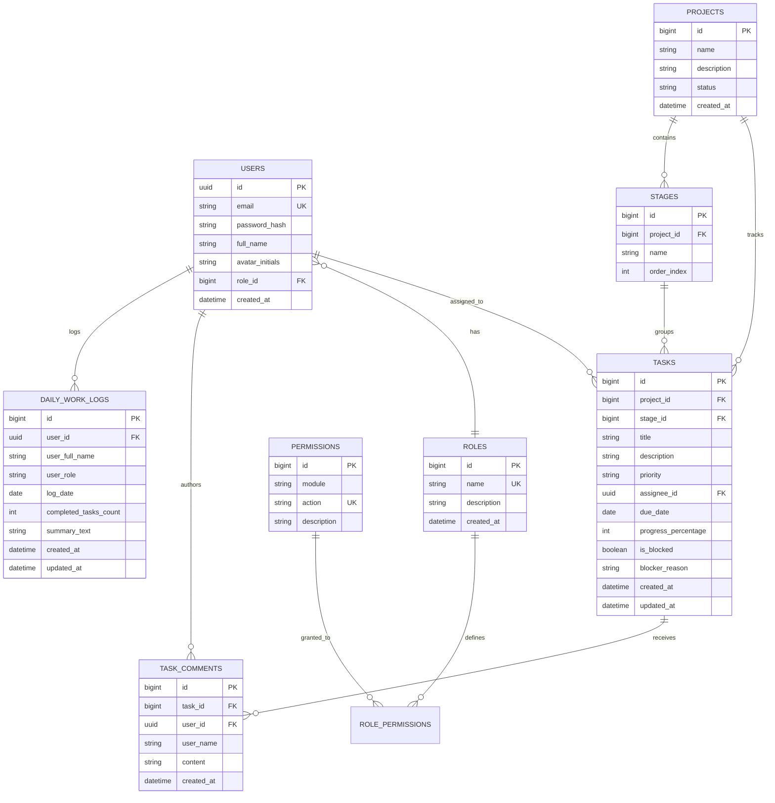

# 🚀 SyncFlow — Enterprise Collaborative Project Management & Workflow Orchestration Suite

<p align="center">
  
  
  
  
  
  
  
</p>

---

## 📑 Table of Contents

- [1. Executive Overview](#1-executive-overview)
- [2. Architectural Highlights & Clean Architecture](#2-architectural-highlights--clean-architecture)
- [3. Core Enterprise Features](#3-core-enterprise-features)
- [4. Technology Stack](#4-technology-stack)
- [5. System Architecture & Component Flow](#5-system-architecture--component-flow)
- [6. Database Architecture & ER Diagram](#6-database-architecture--er-diagram)
- [7. Directory & Package Structure](#7-directory--package-structure)
- [8. Getting Started & Installation Guide](#8-getting-started--installation-guide)
- [9. Default Seed Accounts & Security Matrix](#9-default-seed-accounts--security-matrix)
- [10. REST API & WebSocket Documentation](#10-rest-api--websocket-documentation)
- [11. Contributing & Author](#11-contributing--author)

---

## 1. Executive Overview

**SyncFlow** is an enterprise-grade collaborative project management and team operations platform built specifically for high-security, compliance-driven environments like banking, fintech, and critical infrastructure.

Unlike fragmented toolsets that require separate subscriptions for sprint tracking, team messaging, video calling, and access control, SyncFlow integrates the complete team lifecycle under a unified **Bank-Grade Emerald Reserve (`#006022`) & Champagne Gold Design System**:

* **Sprint Board with Live STOMP Synchronization**: Drag-and-drop Kanban workflow with sub-millisecond multi-client synchronization.
* **Granular RBAC Permission Matrix & Staff Role Assignment**: Dynamic role creation, permission toggles per functional module, and instant bank member role reassignment.
* **Multi-Project Workspace Orchestration**: Instant project provisioning with automatic workflow stage pipeline creation.
* **Slide-Over Task Details & Real-Time Comment Threads**: Inline assignee reassignment, due date tracking, priority tags, blocker alerts, and team comments.
* **Daily Standup & EOD Work Log System**: Individual work log submissions, auto-calculated daily task completion metrics, and real-time team activity logs.
* **Integrated In-App Video Conferencing**: One-click Jitsi Meet audio/video conference rooms embedded seamlessly without external tools.
* **Enterprise Team Discussions**: Channel-based persistent messaging and team communication.

---

## 2. Architectural Highlights & Clean Architecture

SyncFlow is engineered from the ground up adhering to **Clean Architecture (Hexagonal / Ports and Adapters)** across both backend and frontend layers:

```
[ External Clients / Web UI ]
             │
             ▼ (HTTP / STOMP)
┌─────────────────────────────────────────────────────────────┐
│                       WEB ADAPTERS                          │
│          REST Controllers  •  WebSocket Endpoints           │
└────────────────────────────┬────────────────────────────────┘
                             │
                             ▼ (Inbound Ports)
┌─────────────────────────────────────────────────────────────┐
│                    APPLICATION LAYER                        │
│          Use Cases (Ports In)  •  Domain Services           │
└────────────────────────────┬────────────────────────────────┘
                             │
                             ▼ (Outbound Ports)
┌─────────────────────────────────────────────────────────────┐
│                   PERSISTENCE ADAPTERS                      │
│         Spring Data JPA Repositories  •  MSSQL DB           │
└─────────────────────────────────────────────────────────────┘
```

### Architectural Principles:
1. **Domain Independence**: Business entities and core workflow logic have zero dependencies on frameworks, databases, or transport protocols.
2. **Ports and Adapters**: Inbound ports (`*UseCase`) govern application input; outbound ports define persistence contracts.
3. **Frontend Facade Pattern**: The Angular frontend coordinates state, signals, and asynchronous data through domain Facades (`BoardFacade`, `RbacFacade`, `ChatFacade`), completely decoupling presentation components from transport services.
4. **Relational Integrity on MSSQL**: Full transactional consistency with strict foreign key constraints, cascading lifecycle hooks, and audit logging on Microsoft SQL Server.

---

## 3. Core Enterprise Features

### 🎯 1. Interactive Sprint Kanban Board
* Multi-stage customizable columns (*Backlog*, *In Development*, *Code Review & QA*, *Done & Verified*).
* Real-time drag-and-drop task progression synchronized across all connected browsers over STOMP WebSocket topics (`/topic/board/{projectId}`).
* Multi-criteria filtering: Quick filters for *My Assigned*, *Blocked Only*, and *Critical & High Priority*, alongside real-time search by task title or code.
* Blocker flags with custom blocker reason modals and visual warnings.

### 🛡️ 2. Dynamic RBAC Matrix & Staff Role Reassignment
* **Custom Role Creator**: Create arbitrary custom roles on the fly (e.g. `AUDIT_COMPLIANCE_OFFICER`, `RELEASE_MANAGER`).
* **Granular Permission Matrix**: Module-level permission toggles across `KANBAN_BOARD`, `PROJECT_MANAGEMENT`, `TEAM_CHAT`, `VIDEO_CONFERENCE`, `SPRINT_CYCLE`, `FINANCE_BUDGET`, `RELEASE_DEPLOY`, `ANALYTICS_REPORTS`, and `AUDIT_LOGS`.
* **Bank Member Roles Sub-Tab**: Dedicated member grid displaying staff avatars, emails, and interactive dropdown selectors to reassign roles with immediate persistence to MSSQL `users` table.

### 🏢 3. Enterprise Project Orchestration
* Top-header and sidebar `+ New Project` creation modal.
* Automated stage bootstrapping: New projects automatically initialize with the canonical 4-stage pipeline for instant developer productivity.
* Dynamic workspace switching with responsive progress tracking.

### 📝 4. Slide-Over Task Details Drawer
* Deep inspection of task metadata without leaving the board view.
* Inline dropdown to reassign task ownership to any active bank member.
* Native HTML5 date picker for strict sprint deadline enforcement.
* Real-time threaded task comments with author initials, timestamps, and STOMP broadcast.

### ⏱️ 5. Daily Standup & EOD Work Log System
* Dedicated slide-over drawer accessible directly from the header navigation.
* Automatic calculation of tasks moved to *Done* on the selected date.
* EOD notes composer for blockers, architectural decisions, and next-day priorities.
* **Team Activity Logs Tab**: Unified chronological feed of all team members' daily submissions.

### 🎥 6. Integrated In-App Video Conferencing
* Direct integration with Jitsi Meet embedded frame.
* Instant meeting room provisioning with secure room identifiers matching project codes.
* Full audio, HD video, screen sharing, and participant controls directly inside the dashboard.

### 💬 7. Team Discussion Channels
* Persistent channels (`#general`, `#core-banking-api`, `#design-tokens`, `#database-migration`).
* Real-time message broadcast with author tags and timestamps.

---

## 4. Technology Stack

### Backend
* **Language & Runtime**: Java 21 (LTS)
* **Framework**: Spring Boot 3.4.1
* **Security**: Spring Security 6, Stateless JWT Authentication, BCrypt Password Encoding
* **Real-Time Communication**: Spring WebSocket with STOMP broker and SockJS fallback
* **ORM & Persistence**: Spring Data JPA, Hibernate Core
* **Database Driver**: Microsoft JDBC Driver for SQL Server (`mssql-jdbc`)
* **Build System**: Apache Maven 3.9+

### Frontend
* **Framework**: Angular 19 (Standalone Components, Signals API)
* **Reactive Engine**: RxJS 7.8, Angular Signals
* **Real-Time Client**: `@stomp/rx-stomp`, `sockjs-client`
* **Styling**: SCSS Design System with Bank-Grade Palette, Glassmorphism, and Fluid Transitions
* **Icons**: Inline SVG Design System (Zero external font dependencies)
* **Video SDK**: Jitsi Meet External API

### Database & Infrastructure
* **Database**: Microsoft SQL Server 2022 / Express (`syncflow_db`)
* **Host OS Support**: Windows 11 / Windows Server, Linux (Ubuntu 22.04+), macOS
* **Web Server / Reverse Proxy**: Nginx (Production ready)

---

## 5. System Architecture & Component Flow


---

## 6. Database Architecture & ER Diagram



---

## 7. Directory & Package Structure

```
SyncFlow/
├── backend/
│   ├── src/main/java/com/syncflow/
│   │   ├── auth/
│   │   │   ├── adapter/web/AuthController.java
│   │   │   ├── application/port/in/AuthUseCase.java
│   │   │   ├── application/service/AuthApplicationService.java
│   │   │   └── domain/model/User.java
│   │   ├── project/
│   │   │   ├── adapter/web/ProjectController.java
│   │   │   ├── application/port/in/ProjectUseCase.java
│   │   │   └── application/service/ProjectApplicationService.java
│   │   ├── task/
│   │   │   ├── adapter/web/TaskController.java
│   │   │   ├── application/port/in/TaskUseCase.java
│   │   │   └── application/service/TaskApplicationService.java
│   │   ├── rbac/
│   │   │   ├── adapter/web/RoleController.java
│   │   │   ├── application/port/in/RoleUseCase.java
│   │   │   └── application/service/RoleApplicationService.java
│   │   ├── worklog/
│   │   │   ├── adapter/web/DailyWorkLogController.java
│   │   │   ├── application/port/in/DailyWorkLogUseCase.java
│   │   │   └── application/service/DailyWorkLogApplicationService.java
│   │   ├── config/
│   │   │   ├── SecurityConfig.java
│   │   │   ├── WebSocketConfig.java
│   │   │   └── DataInitializer.java
│   │   └── SyncFlowApplication.java
│   └── pom.xml
│
├── frontend/
│   ├── src/app/
│   │   ├── core/
│   │   │   ├── ports/
│   │   │   │   ├── auth.port.ts
│   │   │   │   ├── project.port.ts
│   │   │   │   ├── task.port.ts
│   │   │   │   ├── rbac.port.ts
│   │   │   │   └── worklog.port.ts
│   │   │   └── services/
│   │   │       ├── auth.service.ts
│   │   │       ├── project.service.ts
│   │   │       ├── task.service.ts
│   │   │       ├── rbac.service.ts
│   │   │       ├── rx-stomp.service.ts
│   │   │       └── worklog.service.ts
│   │   ├── features/
│   │   │   ├── board/application/board.facade.ts
│   │   │   ├── rbac/application/rbac.facade.ts
│   │   │   └── chat/application/chat.facade.ts
│   │   └── pages/
│   │       ├── dashboard/
│   │       │   ├── dashboard.component.ts
│   │       │   ├── dashboard.component.html
│   │       │   └── dashboard.component.scss
│   │       └── login/
│   │           ├── login.component.ts
│   │           ├── login.component.html
│   │           └── login.component.scss
│   ├── angular.json
│   └── package.json
│
├── README.md
└── .gitignore
```

---

## 8. Getting Started & Installation Guide

### Prerequisites
* **Java Development Kit**: JDK 21+
* **Node.js**: v20.x or v22.x LTS (with npm 10+)
* **Database**: Microsoft SQL Server 2022 (Developer / Express edition)
* **Build Tool**: Maven 3.9+

---

### Step 1: Microsoft SQL Server Database Setup
Open SQL Server Management Studio (SSMS) or `sqlcmd` and execute:

```sql
-- Create the dedicated SyncFlow database
CREATE DATABASE syncflow_db;
GO

-- Create the dedicated SQL Server login
USE master;
GO
CREATE LOGIN syncflow_user WITH PASSWORD = 'SyncFlow@2026!', CHECK_POLICY = OFF;
GO

-- Grant database owner privileges
USE syncflow_db;
GO
CREATE USER syncflow_user FOR LOGIN syncflow_user;
GO
ALTER ROLE db_owner ADD MEMBER syncflow_user;
GO
```

---

### Step 2: Backend Configuration & Launch
Verify the connection string in `backend/src/main/resources/application.yml`:

```yaml
server:
  port: 9090
  servlet:
    context-path: /api

spring:
  datasource:
    url: jdbc:sqlserver://localhost:1433;databaseName=syncflow_db;encrypt=true;trustServerCertificate=true;sendStringParametersAsUnicode=false
    username: syncflow_user
    password: SyncFlow@2026!
    driver-class-name: com.microsoft.sqlserver.jdbc.SQLServerDriver
  jpa:
    hibernate:
      ddl-auto: update
    show-sql: false
```

Start the Spring Boot backend service:
```bash
cd backend
./mvnw clean spring-boot:run
```
* The backend will start on port `9090`.
* The `DataInitializer` will automatically seed default roles, permissions, enterprise projects, Kanban stages, and users if tables are empty.

---

### Step 3: Frontend Installation & Launch
```bash
cd frontend
npm install
npm start
```
* The Angular dev server will launch at `http://localhost:4200`.
* All API calls route automatically to `http://localhost:9090/api`.

---

## 9. Default Seed Accounts & Security Matrix

Upon initial database initialization, the following pre-configured enterprise accounts are available:

| Full Name | Email Address | Password | Role | Primary Permissions |
| :--- | :--- | :--- | :--- | :--- |
| **Girish Admin** | `admin@syncflow.bank` | `Admin@123` | `ADMIN` | Full System Access, RBAC Matrix, All Modules |
| **Tariq Manager** | `manager@syncflow.bank` | `Manager@123` | `REPORTING_MANAGER` | Analytics, Sprint Health, Sprints, Team |
| **Arman Lead** | `lead@syncflow.bank` | `Lead@123` | `TECH_LEAD` | Architecture, Code Review, Sprint Execution |
| **Farhan Senior Dev** | `dev@syncflow.bank` | `Dev@123` | `DEVELOPER` | Task Management, Comments, Standup Logs |
| **Sarah SQA** | `sqa@syncflow.bank` | `Sqa@123` | `SQA_ENGINEER` | QA Verification, Bug Tracking, Release Sign-off |

---

## 10. REST API & WebSocket Documentation

### Authentication & RBAC
* `POST /api/v1/auth/login` — Authenticate user and issue JWT bearer token.
* `GET  /api/v1/auth/users` — Fetch all registered bank staff members.
* `PUT  /api/v1/auth/users/{userId}/role` — Reassign bank member's active role.
* `GET  /api/v1/roles` — Fetch all system roles and their granted permissions.
* `POST /api/v1/roles` — Create a new custom role with description.
* `PUT  /api/v1/roles/{roleId}/permissions` — Update permission matrix checkboxes for a role.

### Projects & Stages
* `GET  /api/v1/projects` — Retrieve all enterprise projects with stage metadata.
* `POST /api/v1/projects` — Provision a new project and initialize canonical workflow stages.
* `GET  /api/v1/projects/{projectId}/stages` — List pipeline stages for a project.

### Tasks & Comments
* `GET  /api/v1/tasks?projectId={id}` — Retrieve all tasks for a project.
* `POST /api/v1/tasks` — Create a new task in a specific stage.
* `PUT  /api/v1/tasks/{id}/move` — Move task across stages (triggers WebSocket broadcast).
* `PUT  /api/v1/tasks/{id}/details` — Update title, description, priority, assignee, due date.
* `PUT  /api/v1/tasks/{id}/blocker` — Toggle blocker flag and set blocker explanation.
* `GET  /api/v1/tasks/{taskId}/comments` — Retrieve threaded comment discussion.
* `POST /api/v1/tasks/{taskId}/comments` — Post a comment (broadcasted in real time).

### Daily Standup & Work Logs
* `GET  /api/v1/worklogs/my?date=YYYY-MM-DD` — Retrieve authenticated user's log for date.
* `POST /api/v1/worklogs` — Submit or update standup notes and completed task count.
* `GET  /api/v1/worklogs/team?date=YYYY-MM-DD` — Retrieve all team activity logs for date.

### WebSocket STOMP Broker Topics
* `CONNECT /ws` — WebSocket STOMP endpoint with SockJS fallback.
* `SUBSCRIBE /topic/board/{projectId}` — Real-time Kanban task movements, creations, and edits.
* `SUBSCRIBE /topic/channel/{channelId}` — Real-time team discussion messages.
* `SUBSCRIBE /topic/task/{taskId}/comments` — Live task comment stream.
* `SEND /app/chat.send` — Dispatch message payload to channel.

---

## 11. Contributing & Author

Developed and maintained by **Girish Mondal** as a modern, high-performance, and secure project operations system for enterprise engineering squads.

* **GitHub Repository**: [https://github.com/Girishiam/SyncFlow](https://github.com/Girishiam/SyncFlow)
* **Author**: Girish Mondal
* **License**: This project is licensed under the **MIT License** — feel free to customize and deploy.
