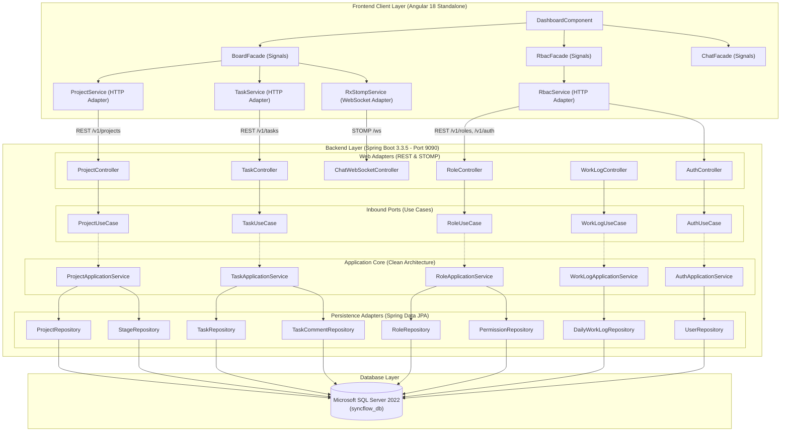
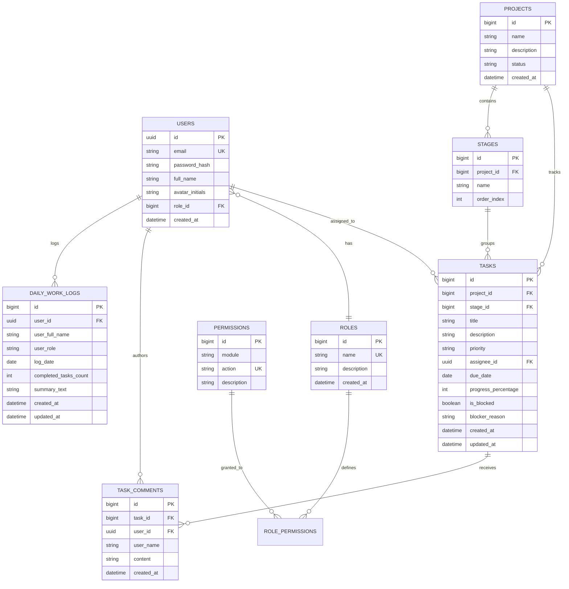

# 🚀 SyncFlow — Enterprise Collaborative Project Management & Workflow Orchestration Suite

<p align="center">
  <a href="https://github.com/Girishiam/SyncFlow/actions/workflows/ci.yml"></a>
  
  
  
  
  
  
  
</p>

---

## 📑 Table of Contents

- [1. Executive Overview](#1-executive-overview)
- [2. Architectural Highlights & Clean Architecture](#2-architectural-highlights--clean-architecture)
- [3. Core Enterprise Features](#3-core-enterprise-features)
- [4. Technology Stack](#4-technology-stack)
- [5. System Architecture & Component Flow](#5-system-architecture--component-flow)
- [6. Database Architecture & ER Diagram](#6-database-architecture--er-diagram)
- [7. Directory & Package Structure](#7-directory--package-structure)
- [8. Getting Started & Installation Guide](#8-getting-started--installation-guide)
- [9. Demo Accounts (dev profile only) & Permission Model](#9-demo-accounts-dev-profile-only--permission-model)
- [10. REST API & WebSocket Documentation](#10-rest-api--websocket-documentation)
- [11. Contributing & Author](#11-contributing--author)

---

## 1. Executive Overview

**SyncFlow** is an enterprise-grade collaborative project management and team operations platform built specifically for high-security, compliance-driven environments like banking, fintech, and critical infrastructure.

Unlike fragmented toolsets that require separate subscriptions for sprint tracking, team messaging, video calling, and access control, SyncFlow integrates the complete team lifecycle under a unified **Bank-Grade Emerald Reserve (`#006022`) & Champagne Gold Design System**:

* **Sprint Board with Live STOMP Synchronization**: Drag-and-drop Kanban workflow with sub-millisecond multi-client synchronization.
* **Granular RBAC Permission Matrix & Staff Role Assignment**: Dynamic role creation, permission toggles per functional module, and instant bank member role reassignment.
* **Multi-Project Workspace Orchestration**: Instant project provisioning with automatic workflow stage pipeline creation.
* **Slide-Over Task Details & Real-Time Comment Threads**: Inline assignee reassignment, due date tracking, priority tags, blocker alerts, and team comments.
* **Daily Standup & EOD Work Log System**: Individual work log submissions, auto-calculated daily task completion metrics, and real-time team activity logs.
* **Integrated In-App Video Conferencing**: One-click Jitsi Meet audio/video conference rooms embedded seamlessly without external tools.
* **Enterprise Team Discussions**: Channel-based persistent messaging and team communication.

---

## 2. Architectural Highlights & Clean Architecture

SyncFlow is engineered from the ground up adhering to **Clean Architecture (Hexagonal / Ports and Adapters)** across both backend and frontend layers:

```
[ External Clients / Web UI ]
             │
             ▼ (HTTP / STOMP)
┌─────────────────────────────────────────────────────────────┐
│                       WEB ADAPTERS                          │
│          REST Controllers  •  WebSocket Endpoints           │
└────────────────────────────┬────────────────────────────────┘
                             │
                             ▼ (Inbound Ports)
┌─────────────────────────────────────────────────────────────┐
│                    APPLICATION LAYER                        │
│          Use Cases (Ports In)  •  Domain Services           │
└────────────────────────────┬────────────────────────────────┘
                             │
                             ▼ (Outbound Ports)
┌─────────────────────────────────────────────────────────────┐
│                   PERSISTENCE ADAPTERS                      │
│         Spring Data JPA Repositories  •  MSSQL DB           │
└─────────────────────────────────────────────────────────────┘
```

### Architectural Principles:
1. **Domain Independence**: Business entities and core workflow logic have zero dependencies on frameworks, databases, or transport protocols.
2. **Ports and Adapters**: Inbound ports (`*UseCase`) govern application input; outbound ports define persistence contracts.
3. **Frontend Facade Pattern**: The Angular frontend coordinates state, signals, and asynchronous data through domain Facades (`BoardFacade`, `RbacFacade`, `ChatFacade`), completely decoupling presentation components from transport services.
4. **Relational Integrity on MSSQL**: Full transactional consistency with strict foreign key constraints, cascading lifecycle hooks, and audit logging on Microsoft SQL Server.

---

## 3. Core Enterprise Features

### 🎯 1. Interactive Sprint Kanban Board
* Multi-stage customizable columns (*Backlog*, *In Development*, *Code Review & QA*, *Done & Verified*).
* Real-time drag-and-drop task progression synchronized across all connected browsers over STOMP WebSocket topics (`/topic/projects.{projectId}.board`).
* Multi-criteria filtering: Quick filters for *My Assigned*, *Blocked Only*, and *Critical & High Priority*, alongside real-time search by task title or code.
* Blocker flags with custom blocker reason modals and visual warnings.

### 🛡️ 2. Dynamic RBAC Matrix & Staff Role Reassignment
* **Custom Role Creator**: Create arbitrary custom roles on the fly (e.g. `AUDIT_COMPLIANCE_OFFICER`, `RELEASE_MANAGER`).
* **Granular Permission Matrix**: Module-level permission toggles across `KANBAN_BOARD`, `PROJECT_MANAGEMENT`, `TEAM_CHAT`, `VIDEO_CONFERENCE`, `SPRINT_CYCLE`, `FINANCE_BUDGET`, `RELEASE_DEPLOY`, `ANALYTICS_REPORTS`, and `AUDIT_LOGS`.
* **Bank Member Roles Sub-Tab**: Dedicated member grid displaying staff avatars, emails, and interactive dropdown selectors to reassign roles with immediate persistence to MSSQL `users` table.

### 🏢 3. Enterprise Project Orchestration
* Top-header and sidebar `+ New Project` creation modal.
* Automated stage bootstrapping: New projects automatically initialize with the canonical 4-stage pipeline for instant developer productivity.
* Dynamic workspace switching with responsive progress tracking.

### 📝 4. Slide-Over Task Details Drawer
* Deep inspection of task metadata without leaving the board view.
* Inline dropdown to reassign task ownership to any active bank member.
* Native HTML5 date picker for strict sprint deadline enforcement.
* Real-time threaded task comments with author initials, timestamps, and STOMP broadcast.

### ⏱️ 5. Daily Standup & EOD Work Log System
* Dedicated slide-over drawer accessible directly from the header navigation.
* Automatic calculation of tasks moved to *Done* on the selected date.
* EOD notes composer for blockers, architectural decisions, and next-day priorities.
* **Team Activity Logs Tab**: Unified chronological feed of all team members' daily submissions.

### 🎥 6. Integrated In-App Video Conferencing
* Direct integration with Jitsi Meet embedded frame.
* Instant meeting room provisioning with secure room identifiers matching project codes.
* Full audio, HD video, screen sharing, and participant controls directly inside the dashboard.

### 💬 7. Team Discussion Channels
* Persistent channels (`#general`, `#core-banking-api`, `#design-tokens`, `#database-migration`).
* Real-time message broadcast with author tags and timestamps.

---

## 4. Technology Stack

### Backend
* **Language & Runtime**: Java 21 (LTS)
* **Framework**: Spring Boot 3.3.5
* **Security**: Spring Security 6, Stateless JWT Authentication, BCrypt Password Encoding
* **Real-Time Communication**: Spring WebSocket + STOMP (token-authenticated CONNECT, per-subscription authorization)
* **ORM & Persistence**: Spring Data JPA, Hibernate (schema validation), Flyway migrations
* **Database Driver**: Microsoft JDBC Driver for SQL Server (`mssql-jdbc`)
* **Build System**: Apache Maven 3.9+

### Frontend
* **Framework**: Angular 18.2 (Standalone Components, Signals API, lazy-loaded routes)
* **Reactive Engine**: RxJS 7.8, Angular Signals
* **Real-Time Client**: `@stomp/stompjs` over native WebSocket
* **Styling**: SCSS Design System with Bank-Grade Palette, Glassmorphism, and Fluid Transitions
* **Icons**: Inline SVG Design System (Zero external font dependencies)
* **Video SDK**: Jitsi Meet External API

### Database & Infrastructure
* **Database**: Microsoft SQL Server 2022 / Express (`syncflow_db`)
* **Host OS Support**: Windows 11 / Windows Server, Linux (Ubuntu 22.04+), macOS
* **Web Server / Reverse Proxy**: Nginx (Production ready)

---

## 5. System Architecture & Component Flow



---

## 6. Database Architecture & ER Diagram



---

## 7. Directory & Package Structure

```
SyncFlow/
├── backend/
│   ├── src/main/java/com/syncflow/
│   │   ├── auth/
│   │   │   ├── adapter/web/AuthController.java
│   │   │   ├── application/port/in/AuthUseCase.java
│   │   │   ├── application/service/AuthApplicationService.java
│   │   │   └── domain/model/User.java
│   │   ├── project/
│   │   │   ├── adapter/web/ProjectController.java
│   │   │   ├── application/port/in/ProjectUseCase.java
│   │   │   └── application/service/ProjectApplicationService.java
│   │   ├── task/
│   │   │   ├── adapter/web/TaskController.java
│   │   │   ├── application/port/in/TaskUseCase.java
│   │   │   └── application/service/TaskApplicationService.java
│   │   ├── rbac/
│   │   │   ├── adapter/web/RoleController.java
│   │   │   ├── application/port/in/RoleUseCase.java
│   │   │   └── application/service/RoleApplicationService.java
│   │   ├── worklog/
│   │   │   ├── adapter/web/DailyWorkLogController.java
│   │   │   ├── application/port/in/DailyWorkLogUseCase.java
│   │   │   └── application/service/DailyWorkLogApplicationService.java
│   │   ├── config/
│   │   │   ├── SecurityConfig.java
│   │   │   ├── WebSocketConfig.java
│   │   │   └── DataInitializer.java
│   │   └── SyncFlowApplication.java
│   └── pom.xml
│
├── frontend/
│   ├── src/app/
│   │   ├── core/
│   │   │   ├── ports/
│   │   │   │   ├── auth.port.ts
│   │   │   │   ├── project.port.ts
│   │   │   │   ├── task.port.ts
│   │   │   │   ├── rbac.port.ts
│   │   │   │   └── worklog.port.ts
│   │   │   └── services/
│   │   │       ├── auth.service.ts
│   │   │       ├── project.service.ts
│   │   │       ├── task.service.ts
│   │   │       ├── rbac.service.ts
│   │   │       ├── rx-stomp.service.ts
│   │   │       └── worklog.service.ts
│   │   ├── features/
│   │   │   ├── board/application/board.facade.ts
│   │   │   ├── rbac/application/rbac.facade.ts
│   │   │   └── chat/application/chat.facade.ts
│   │   └── pages/
│   │       ├── dashboard/
│   │       │   ├── dashboard.component.ts
│   │       │   ├── dashboard.component.html
│   │       │   └── dashboard.component.scss
│   │       └── login/
│   │           ├── login.component.ts
│   │           ├── login.component.html
│   │           └── login.component.scss
│   ├── angular.json
│   └── package.json
│
├── README.md
└── .gitignore
```

---

## 8. Getting Started & Installation Guide

### Prerequisites
* **Java Development Kit**: JDK 21+
* **Node.js**: v20.x or v22.x LTS (with npm 10+)
* **Database**: Microsoft SQL Server 2022 (Developer / Express edition)
* **Build Tool**: Maven 3.9+ (or the bundled `./mvnw`)

---

### Step 1: Microsoft SQL Server Database Setup
Open SQL Server Management Studio (SSMS) or `sqlcmd` and execute (choose your own password):

```sql
CREATE DATABASE syncflow_db;
GO
USE master;
GO
CREATE LOGIN syncflow_user WITH PASSWORD = '<choose-a-strong-password>';
GO
USE syncflow_db;
GO
CREATE USER syncflow_user FOR LOGIN syncflow_user;
GO
ALTER ROLE db_owner ADD MEMBER syncflow_user;
GO
```

The schema is created and upgraded by **Flyway** migrations (`backend/src/main/resources/db/migration`) on startup; Hibernate only validates it. An existing database that was previously managed by `ddl-auto=update` is baselined at version 1 automatically and then upgraded.

---

### Step 2: Backend Configuration & Launch
Secrets are never committed. Provide them through environment variables **or** a git-ignored `backend/config/application-local.yml` (copy `backend/config/application-local.example.yml`):

| Setting | Environment variable | Notes |
| :--- | :--- | :--- |
| DB password | `SYNCFLOW_DB_PASSWORD` | Required |
| DB URL / user | `SYNCFLOW_DB_URL`, `SYNCFLOW_DB_USERNAME` | Defaults to local `syncflow_db` / `syncflow_user` |
| JWT signing key | `SYNCFLOW_JWT_SECRET` | Required, Base64, ≥ 32 bytes: `openssl rand -base64 48` |
| First administrator | `SYNCFLOW_ADMIN_EMAIL`, `SYNCFLOW_ADMIN_PASSWORD` | Created once when no users exist (non-`dev` environments) |
| Allowed browser origins | `SYNCFLOW_CORS_ORIGINS` | Comma separated; also used for WebSocket origins |
| Attachment storage | `SYNCFLOW_ATTACHMENTS_DIR` | Default `./data/attachments` |
| Webhooks to private networks | `SYNCFLOW_WEBHOOKS_ALLOW_PRIVATE` | `false` by default (SSRF protection) |

```bash
cd backend
./mvnw spring-boot:run
```
* The API listens on port `9090` under `/api`.
* Run with the `dev` profile (`spring.profiles.active: dev`, set in the example local config) to load demo projects, users, sprints and chat history.

---

### Step 3: Frontend Installation & Launch
```bash
cd frontend
npm install
npm start          # ng serve on http://localhost:4200, API at http://localhost:9090/api
npm run build      # production build; expects the API on the same origin under /api
```
API and WebSocket locations are configured in `frontend/src/environments/`.

### Running tests
```bash
cd backend && ./mvnw test                                   # unit + security slice tests (no database needed)
SYNCFLOW_IT_DB=true ./mvnw test                             # additionally boots the full context against SQL Server
cd frontend && npx ng test --watch=false --browsers=ChromeHeadless
```

---

## 9. Demo Accounts (dev profile only) & Permission Model

With the `dev` profile, these demo accounts are created. **They do not exist in other environments** — create the first administrator with `SYNCFLOW_ADMIN_EMAIL` / `SYNCFLOW_ADMIN_PASSWORD` instead.

| Full Name | Email Address | Password | Role |
| :--- | :--- | :--- | :--- |
| Chief Admin | `admin@syncflow.bank` | `Admin@123` | `ADMIN` |
| Tariq Manager | `manager@syncflow.bank` | `Manager@123` | `REPORTING_MANAGER` |
| Arman Lead | `lead@syncflow.bank` | `Lead@123` | `TEAM_LEAD` |
| Farhan Senior Dev | `dev@syncflow.bank` | `Dev@123` | `DEVELOPER` |
| Sarah SQA Engineer | `sqa@syncflow.bank` | `Sqa@123` | `SQA` |

**Every endpoint is authorised on the server** with two checks:
1. **Role permission** (`MODULE:ACTION`, editable in the RBAC matrix), e.g. `TASK:EDIT`, `SPRINT:MANAGE`, `FINANCE:VIEW`, `AUDIT:VIEW`, `ADMIN:MANAGE_USERS`. `ADMIN` has every permission; a deactivated role grants none.
2. **Resource access**: a project with a team is limited to its manager, team lead and members (projects without a team are organisation-wide); private channels are limited to their members.

Overriding a failed workflow gate additionally requires `TASK:OVERRIDE_GATE`, re-entering the password (`POST /v1/auth/elevate`, valid 5 minutes) and a written justification. Every override is recorded in the hash-chained audit ledger.

Sessions use a 15-minute access token plus a single-use refresh token (rotated on every refresh; reuse of an old refresh token revokes all of the user's sessions). Five failed password attempts lock the account for 15 minutes.

---

## 10. REST API & WebSocket Documentation

All endpoints are under `/api`. Errors share one JSON shape: `{ timestamp, status, error, code, message, path, details[] }` (for example `code: "WORKFLOW_GATE_VIOLATION"` with the failed gates in `details`).

### Authentication & RBAC
* `POST /v1/auth/login` — Returns `{ token, expiresIn, refreshToken, user }`.
* `POST /v1/auth/refresh` — Exchange a refresh token for a new token pair.
* `POST /v1/auth/logout` — Revoke a refresh token.
* `POST /v1/auth/elevate` — Re-enter the password to obtain a short-lived elevation token (`scope: WORKFLOW_GATE_OVERRIDE`).
* `GET  /v1/auth/me`, `GET /v1/auth/users`
* `PUT  /v1/auth/users/{id}/role` — `ADMIN:MANAGE_USERS`; cannot change your own role or remove the last admin.
* `GET/POST /v1/rbac/roles`, `PUT /v1/rbac/roles/{id}/permissions`, `PUT /v1/rbac/roles/{id}/toggle-status`, `DELETE /v1/rbac/roles/{id}` — writes need `ADMIN:MANAGE_ROLES`.

### Projects, Stages & Sprints
* `GET  /v1/projects` — Projects visible to the caller. `POST /v1/projects` — `PROJECT:CREATE`.
* `GET  /v1/projects/{id}/board`, `/timeline`, `/analytics/burndown`, `/capacity`, `/time-summary`
* `POST /v1/projects/{id}/stages`, `PUT /v1/projects/stages/{stageId}` — create/update a stage and its quality gates (`requiresChecklistComplete`, `requiresNoBlockers`, `requiresDeliverable`).
* `GET/POST /v1/projects/{id}/sprints`, `PUT /v1/projects/sprints/{id}/start|complete` — one active sprint per project; completing a sprint returns unfinished tasks to the backlog.
* `GET /v1/projects/{id}/financials` — `FINANCE:VIEW`; cost = logged hours × `syncflow.finance.role-hourly-rates`.
* `GET/POST /v1/projects/{id}/webhooks`, `PUT .../webhooks/{id}/toggle`, `POST .../webhooks/{id}/test`, `DELETE .../webhooks/{id}`

### Tasks
* `POST /v1/tasks`, `GET /v1/tasks/{id}`
* `PUT /v1/tasks/{id}/move` — `{ targetStageId, overrideGate?, overrideReason?, elevationToken? }`; 409 `WORKFLOW_GATE_VIOLATION` when gates fail.
* `PUT /v1/tasks/{id}/progress | blocker | assignee | deadline | story-points | sprint | git | archive | restore`
* `GET/POST /v1/tasks/{id}/comments`, `/subtasks`, `/dependencies`, `/time-logs`
* `POST /v1/tasks/{id}/attachments` — multipart `file` upload (≤ 25 MB) **or** JSON `{ fileName, fileUrl }` for an http(s) link.
* `GET  /v1/tasks/{id}/attachments/{attachmentId}/download`

### Chat, Notifications, Work Logs, Audit
* `GET /v1/channels`, `GET /v1/channels/{id}/messages?before={messageId}&limit=50`, `POST /v1/channels/{id}/messages`
* `GET /v1/notifications`, `PATCH /v1/notifications/{id}/read`, `POST /v1/notifications/mark-all-read` — every notification belongs to one user (role-wide alerts are delivered as one row per recipient).
* `POST /v1/worklogs`, `GET /v1/worklogs/me?date=`, `GET /v1/worklogs?date=`, `GET /v1/worklogs/recent`
* `GET /v1/audit-logs`, `/export/csv` — `AUDIT:VIEW`
* `GET /v1/audit-logs/metrics` — ledger metrics; verifies records appended since the last check (incremental).
* `POST /v1/audit-logs/verify` — full re-verification of the hash chain (also runs nightly at 02:30).

### Webhook deliveries
Events: `TASK_CREATED`, `TASK_MOVED`, `TASK_BLOCKED`, `SPRINT_COMPLETED`. Each delivery is a JSON POST sent after the transaction commits, retried on network errors/429/5xx, with headers `X-SyncFlow-Event`, `X-SyncFlow-Delivery`, `X-SyncFlow-Timestamp` and `X-SyncFlow-Signature: sha256=HMAC_SHA256(secret, "<timestamp>.<body>")`.

### WebSocket (STOMP)
* Endpoint: `/api/ws` (native WebSocket; a SockJS endpoint is also available). The `CONNECT` frame must carry `Authorization: Bearer <access token>`.
* `SUBSCRIBE /topic/projects.{projectId}.board` — task changes for a project (requires access to that project).
* `SUBSCRIBE /topic/projects.{projectId}.blockers` — blocker alerts.
* `SUBSCRIBE /topic/channel.{channelId}` — channel messages (private channels: members only).
* `SUBSCRIBE /user/queue/notifications` — the caller's own notifications.
* Clients cannot `SEND`; all writes go through the REST API.

---

## 11. Contributing & Author

Developed and maintained by **Girish Mondal** as a modern, high-performance, and secure project operations system for enterprise engineering squads.

* **GitHub Repository**: [https://github.com/Girishiam/SyncFlow](https://github.com/Girishiam/SyncFlow)
* **Author**: Girish Mondal
* **License**: This project is licensed under the **MIT License** — feel free to customize and deploy.
