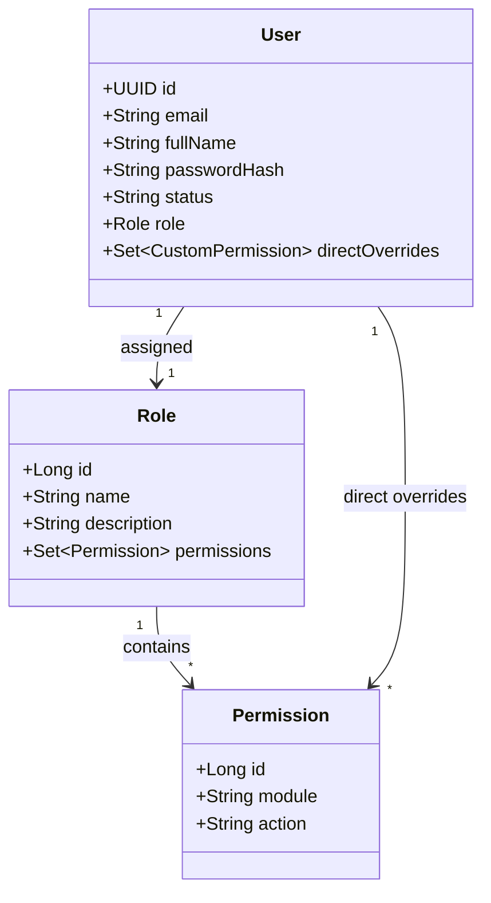
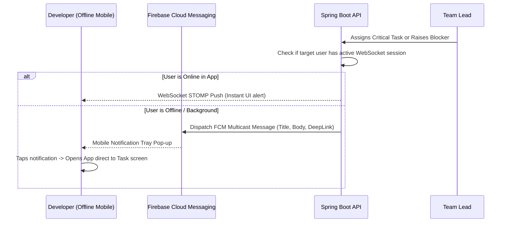

# 🏛️ SyncFlow System Architecture & Technical Specifications

This document outlines the detailed system architecture, interaction flows, real-time messaging protocol, security design, and third-party integrations for **SyncFlow**.

---

## 1. High-Level Architectural Principles

1. **Reactive & Non-Blocking Scalability**:
   - Built on **Java 21 Virtual Threads (Project Loom)** in Spring Boot 3.3+.
   - Requests are bound to lightweight virtual threads (`spring.threads.virtual.enabled=true`), enabling tens of thousands of concurrent connections with minimal memory footprint compared to traditional platform threads.

2. **Unified Single-Codebase Client**:
   - Single frontend application built with **Angular 18+** (Standalone Components, Signals, RxJS).
   - Wrapped via **Capacitor 6+** to generate native Android APK while serving Web/PWA simultaneously without duplicate logic.

3. **Hybrid Real-Time Communication**:
   - **REST APIs**: Used for idempotent CRUD operations, bulk analytics, file attachments, and reporting.
   - **WebSocket (STOMP over SockJS)**: Used for Discord-style live channels, typing indicators, message seen receipts, live Kanban board updates, and blocker alerts.
   - **FCM (Firebase Cloud Messaging)**: Out-of-band push notifications dispatched when client is terminated or in background.

---

## 2. Dynamic RBAC Engine Architecture

### Granular Permission Evaluator Flow
Every sensitive API endpoint and WebSocket subscription is gated by Spring Security's `MethodSecurityExpressionHandler`:
- Custom annotation: `@PreAuthorize("hasPermission(#projectId, 'PROJECT', 'EDIT')")`
- `CustomPermissionEvaluator.java`:
  1. Checks Caffeine in-memory cache for the current user's aggregated permission set (Role Permissions $\cup$ User Overrides).
  2. Evaluates module-level access (`PROJECT`, `TASK`, `MEETING`, `CHAT`, `ADMIN`).
  3. Checks action-level flags (`CREATE`, `VIEW`, `EDIT`, `DELETE`, `APPROVE`, `ASSIGN`, `HOST_MEETING`).
  4. Returns `boolean` in $< 1\text{ms}$.

---

## 3. Real-Time Chat & Seen Protocol (STOMP Destinations)

| Destination | Type | Payload | Description |
| :--- | :--- | :--- | :--- |
| `/app/chat.sendMessage` | Send | `ChatMessageDTO` | Client sends a new message to a channel |
| `/topic/channel/{channelId}` | Subscribe | `ChatMessageDTO` | Subscribers receive incoming messages in real-time |
| `/app/chat.markSeen` | Send | `MarkSeenDTO(messageId, channelId)` | Client acknowledges reading messages |
| `/topic/channel/{channelId}/seen` | Subscribe | `SeenUpdateDTO(messageId, userId, seenAt)` | Broadcasts real-time read receipts ("Seen by...") |
| `/topic/project/{projectId}/kanban` | Subscribe | `TaskStageMoveDTO` | Live sync when another user drags a task card |
| `/topic/alerts/blockers` | Subscribe | `BlockerAlertDTO` | Global alert broadcast to Managers & Team Leads |

---

## 4. In-App Video & Audio Meetings (Jitsi Meet Integration)

SyncFlow integrates Jitsi Meet without requiring external accounts or paid API keys:

1. **Host Action**:
   - Manager or Team Lead clicks *"Start Instant Meeting"* (or generates a meeting link inside a channel).
   - Frontend calls `/api/v1/meetings/create` $\rightarrow$ generates a cryptographically random room ID: `syncflow-room-{uuid}`.
2. **Participant Action**:
   - Web Client embeds `JitsiMeetExternalAPI` inside an Angular modal with custom styling matching SyncFlow's theme.
   - Mobile Client launches via Capacitor In-App Browser or Jitsi Meet Mobile SDK.
   - Zero installation required for participants.

---

## 5. Background Push Notification Flow (FCM)

---

## 6. Performance & Caching Strategy

- **Caffeine In-Memory Cache**:
  - `user_permissions_cache`: TTL 30 minutes, invalidated on role change.
  - `active_projects_summary`: TTL 60 seconds for dashboard KPI cards.
- **Virtual Thread Concurrency**:
  - Heavy database operations run asynchronously using Java 21's `Executors.newVirtualThreadPerTaskExecutor()`.
  - Zero thread pool starvation even with slow database queries or WebSocket keep-alives.
