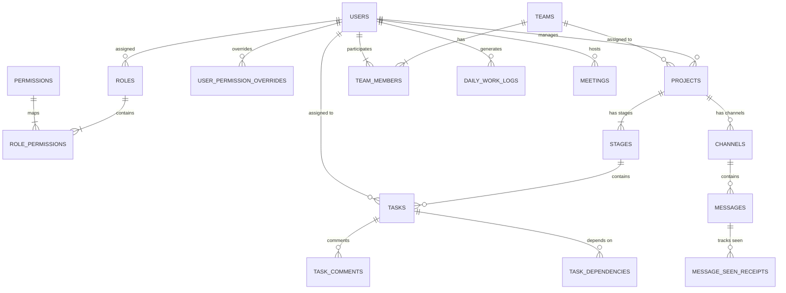

# 🗄️ SyncFlow PostgreSQL 16 Database Schema Specification

This document details the PostgreSQL 16 relational database schema for **SyncFlow**, optimized with B-tree indexes, foreign key constraints, and cascading rules.

---

## 1. Schema Entity Relationship Overview



---

## 2. PostgreSQL DDL Script

```sql
-- Enable UUID extension
CREATE EXTENSION IF NOT EXISTS "uuid-ossp";

-- ==========================================
-- 1. AUTH & DYNAMIC RBAC TABLES
-- ==========================================

CREATE TABLE roles (
    id BIGSERIAL PRIMARY KEY,
    name VARCHAR(50) UNIQUE NOT NULL,
    description TEXT,
    is_system_role BOOLEAN DEFAULT FALSE,
    created_at TIMESTAMP WITH TIME ZONE DEFAULT CURRENT_TIMESTAMP
);

CREATE TABLE permissions (
    id BIGSERIAL PRIMARY KEY,
    module VARCHAR(50) NOT NULL, -- PROJECT, TASK, STAGE, CHAT, MEETING, ADMIN
    action VARCHAR(50) NOT NULL, -- CREATE, VIEW, EDIT, DELETE, APPROVE, ASSIGN, HOST_MEETING
    description TEXT,
    CONSTRAINT uq_module_action UNIQUE (module, action)
);

CREATE TABLE role_permissions (
    role_id BIGINT REFERENCES roles(id) ON DELETE CASCADE,
    permission_id BIGINT REFERENCES permissions(id) ON DELETE CASCADE,
    PRIMARY KEY (role_id, permission_id)
);

CREATE TABLE users (
    id UUID PRIMARY KEY DEFAULT uuid_generate_v4(),
    email VARCHAR(255) UNIQUE NOT NULL,
    password_hash VARCHAR(255) NOT NULL,
    full_name VARCHAR(100) NOT NULL,
    avatar_url TEXT,
    status VARCHAR(20) DEFAULT 'ACTIVE', -- ACTIVE, INACTIVE, SUSPENDED
    on_leave BOOLEAN DEFAULT FALSE,
    leave_note TEXT,
    fcm_token TEXT,
    role_id BIGINT REFERENCES roles(id) ON DELETE SET NULL,
    created_at TIMESTAMP WITH TIME ZONE DEFAULT CURRENT_TIMESTAMP,
    updated_at TIMESTAMP WITH TIME ZONE DEFAULT CURRENT_TIMESTAMP
);

CREATE TABLE user_permission_overrides (
    user_id UUID REFERENCES users(id) ON DELETE CASCADE,
    permission_id BIGINT REFERENCES permissions(id) ON DELETE CASCADE,
    is_granted BOOLEAN NOT NULL DEFAULT TRUE, -- TRUE = Grant override, FALSE = Deny override
    PRIMARY KEY (user_id, permission_id)
);

-- ==========================================
-- 2. TEAMS & SQUADS
-- ==========================================

CREATE TABLE teams (
    id BIGSERIAL PRIMARY KEY,
    name VARCHAR(100) NOT NULL,
    description TEXT,
    lead_id UUID REFERENCES users(id) ON DELETE SET NULL,
    created_at TIMESTAMP WITH TIME ZONE DEFAULT CURRENT_TIMESTAMP
);

CREATE TABLE team_members (
    team_id BIGINT REFERENCES teams(id) ON DELETE CASCADE,
    user_id UUID REFERENCES users(id) ON DELETE CASCADE,
    joined_at TIMESTAMP WITH TIME ZONE DEFAULT CURRENT_TIMESTAMP,
    PRIMARY KEY (team_id, user_id)
);

-- ==========================================
-- 3. PROJECTS & CUSTOM PIPELINE STAGES
-- ==========================================

CREATE TABLE projects (
    id BIGSERIAL PRIMARY KEY,
    name VARCHAR(150) NOT NULL,
    description TEXT,
    status VARCHAR(30) DEFAULT 'ACTIVE', -- ACTIVE, ON_HOLD, COMPLETED, ARCHIVED
    start_date DATE,
    due_date DATE,
    manager_id UUID REFERENCES users(id) ON DELETE SET NULL,
    team_id BIGINT REFERENCES teams(id) ON DELETE SET NULL,
    created_at TIMESTAMP WITH TIME ZONE DEFAULT CURRENT_TIMESTAMP,
    updated_at TIMESTAMP WITH TIME ZONE DEFAULT CURRENT_TIMESTAMP
);

CREATE TABLE stages (
    id BIGSERIAL PRIMARY KEY,
    project_id BIGINT REFERENCES projects(id) ON DELETE CASCADE,
    name VARCHAR(80) NOT NULL, -- e.g., Backlog, DB Design, API, UI, Review, Done
    position INT NOT NULL DEFAULT 0,
    is_done_stage BOOLEAN DEFAULT FALSE,
    created_at TIMESTAMP WITH TIME ZONE DEFAULT CURRENT_TIMESTAMP,
    CONSTRAINT uq_project_stage_pos UNIQUE (project_id, position)
);

-- ==========================================
-- 4. TASKS, BLOCKERS & DEPENDENCIES
-- ==========================================

CREATE TABLE tasks (
    id BIGSERIAL PRIMARY KEY,
    project_id BIGINT REFERENCES projects(id) ON DELETE CASCADE,
    stage_id BIGINT REFERENCES stages(id) ON DELETE SET NULL,
    title VARCHAR(255) NOT NULL,
    description TEXT,
    priority VARCHAR(20) DEFAULT 'MEDIUM', -- LOW, MEDIUM, HIGH, CRITICAL
    deadline TIMESTAMP WITH TIME ZONE,
    progress_percentage INT DEFAULT 0 CHECK (progress_percentage BETWEEN 0 AND 100),
    assignee_id UUID REFERENCES users(id) ON DELETE SET NULL,
    reporter_id UUID REFERENCES users(id) ON DELETE SET NULL,
    is_blocked BOOLEAN DEFAULT FALSE,
    blocker_reason TEXT,
    blocked_at TIMESTAMP WITH TIME ZONE,
    approved_by UUID REFERENCES users(id) ON DELETE SET NULL,
    approved_at TIMESTAMP WITH TIME ZONE,
    created_at TIMESTAMP WITH TIME ZONE DEFAULT CURRENT_TIMESTAMP,
    updated_at TIMESTAMP WITH TIME ZONE DEFAULT CURRENT_TIMESTAMP
);

CREATE TABLE task_dependencies (
    task_id BIGINT REFERENCES tasks(id) ON DELETE CASCADE,
    depends_on_task_id BIGINT REFERENCES tasks(id) ON DELETE CASCADE,
    PRIMARY KEY (task_id, depends_on_task_id)
);

CREATE TABLE task_comments (
    id BIGSERIAL PRIMARY KEY,
    task_id BIGINT REFERENCES tasks(id) ON DELETE CASCADE,
    author_id UUID REFERENCES users(id) ON DELETE SET NULL,
    content TEXT NOT NULL,
    attachment_url TEXT,
    created_at TIMESTAMP WITH TIME ZONE DEFAULT CURRENT_TIMESTAMP
);

-- ==========================================
-- 5. DISCORD-STYLE CHAT & READ RECEIPTS (SEEN)
-- ==========================================

CREATE TABLE channels (
    id BIGSERIAL PRIMARY KEY,
    project_id BIGINT REFERENCES projects(id) ON DELETE CASCADE, -- NULL for Global #general
    name VARCHAR(80) NOT NULL, -- e.g., general, api-discussion, bugs
    type VARCHAR(20) DEFAULT 'TEXT', -- TEXT, VOICE, ANNOUNCEMENT
    created_by UUID REFERENCES users(id) ON DELETE SET NULL,
    created_at TIMESTAMP WITH TIME ZONE DEFAULT CURRENT_TIMESTAMP
);

CREATE TABLE messages (
    id BIGSERIAL PRIMARY KEY,
    channel_id BIGINT REFERENCES channels(id) ON DELETE CASCADE,
    sender_id UUID REFERENCES users(id) ON DELETE SET NULL,
    content TEXT NOT NULL,
    attachment_url TEXT,
    is_pinned BOOLEAN DEFAULT FALSE,
    created_at TIMESTAMP WITH TIME ZONE DEFAULT CURRENT_TIMESTAMP
);

CREATE TABLE message_seen_receipts (
    id BIGSERIAL PRIMARY KEY,
    message_id BIGINT REFERENCES messages(id) ON DELETE CASCADE,
    channel_id BIGINT REFERENCES channels(id) ON DELETE CASCADE,
    user_id UUID REFERENCES users(id) ON DELETE CASCADE,
    seen_at TIMESTAMP WITH TIME ZONE DEFAULT CURRENT_TIMESTAMP,
    CONSTRAINT uq_msg_user_seen UNIQUE (message_id, user_id)
);

-- ==========================================
-- 6. PRODUCTIVITY, LOGS & MEETINGS
-- ==========================================

CREATE TABLE daily_work_logs (
    id BIGSERIAL PRIMARY KEY,
    user_id UUID REFERENCES users(id) ON DELETE CASCADE,
    log_date DATE NOT NULL,
    summary_text TEXT NOT NULL,
    completed_tasks_count INT DEFAULT 0,
    created_at TIMESTAMP WITH TIME ZONE DEFAULT CURRENT_TIMESTAMP,
    CONSTRAINT uq_user_daily_log UNIQUE (user_id, log_date)
);

CREATE TABLE meetings (
    id BIGSERIAL PRIMARY KEY,
    room_id VARCHAR(100) UNIQUE NOT NULL,
    title VARCHAR(200) NOT NULL,
    host_id UUID REFERENCES users(id) ON DELETE SET NULL,
    project_id BIGINT REFERENCES projects(id) ON DELETE CASCADE,
    channel_id BIGINT REFERENCES channels(id) ON DELETE SET NULL,
    status VARCHAR(20) DEFAULT 'ACTIVE', -- ACTIVE, ENDED
    started_at TIMESTAMP WITH TIME ZONE DEFAULT CURRENT_TIMESTAMP,
    ended_at TIMESTAMP WITH TIME ZONE
);

-- ==========================================
-- 7. PERFORMANCE INDEXES
-- ==========================================

CREATE INDEX idx_users_email ON users(email);
CREATE INDEX idx_tasks_project ON tasks(project_id);
CREATE INDEX idx_tasks_assignee ON tasks(assignee_id);
CREATE INDEX idx_tasks_stage ON tasks(stage_id);
CREATE INDEX idx_tasks_blocked ON tasks(is_blocked) WHERE is_blocked = TRUE;
CREATE INDEX idx_messages_channel ON messages(channel_id, created_at DESC);
CREATE INDEX idx_seen_receipts_channel_user ON message_seen_receipts(channel_id, user_id);
CREATE INDEX idx_daily_logs_date ON daily_work_logs(log_date);
```

---

## 3. Seed Data Specification

When running the first time, the migration should seed:
- Roles: `ADMIN`, `REPORTING_MANAGER`, `TEAM_LEAD`, `DEVELOPER`, `SQA`, `OBSERVER`.
- Permissions: 
  - `PROJECT:CREATE`, `PROJECT:VIEW`, `PROJECT:EDIT`, `PROJECT:DELETE`
  - `TASK:CREATE`, `TASK:VIEW`, `TASK:EDIT`, `TASK:DELETE`, `TASK:APPROVE`, `TASK:ASSIGN`
  - `STAGE:BUILD`
  - `MEETING:HOST`
  - `ADMIN:MANAGE_USERS`, `ADMIN:MANAGE_ROLES`
- Channels: Global channel `#general`.
